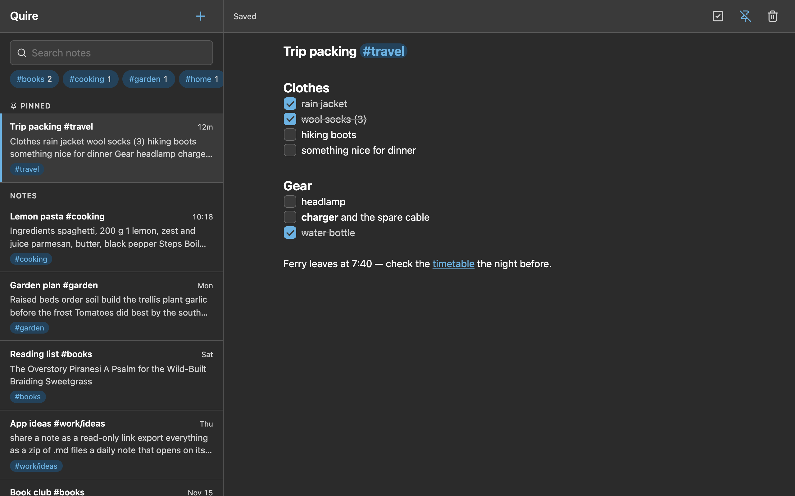
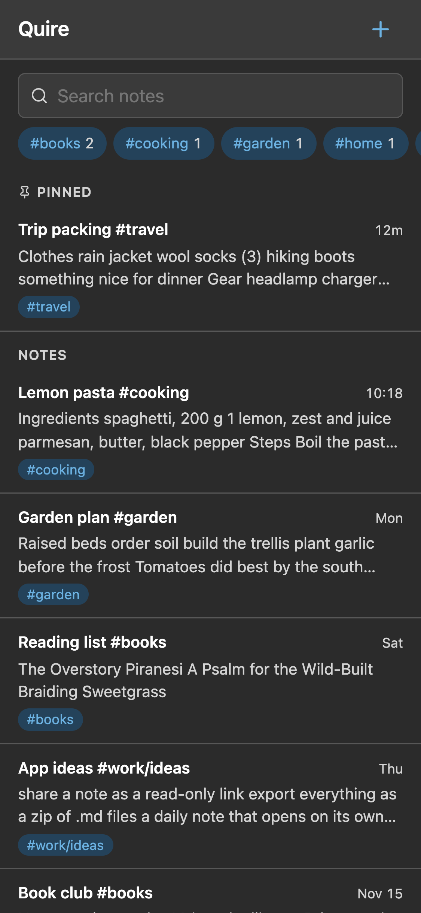
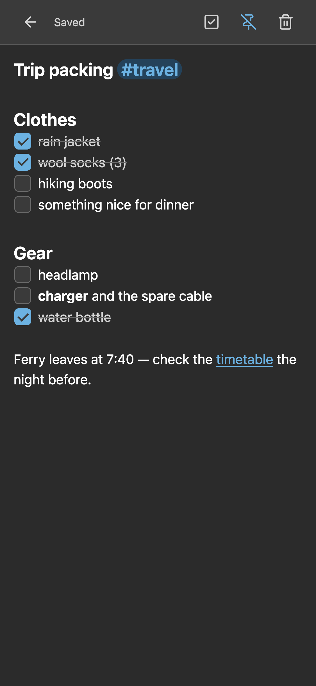
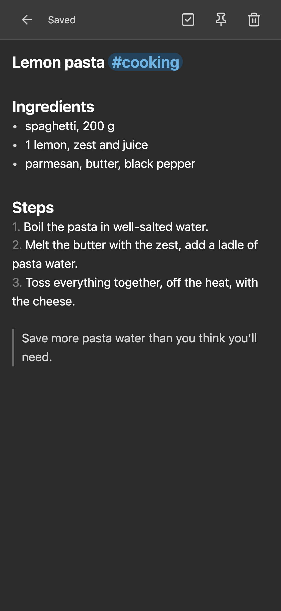

#  Quire

Markdown notes that format as you type. They're kept in one SQLite file on
your own Mac and reached from your phone over Tailscale. Nothing is in the
cloud, and there's no account.

<table>
  <tr>
    <td width="33%"></td>
    <td width="33%"></td>
    <td width="33%"></td>
  </tr>
</table>

The screenshots show made-up demo notes (`npm run demo:data`).

- **Formatted as you type.** There is one screen, not separate edit and
  preview views. Headings come out big, tasks are boxes you can tap, and
  bullets are dots. The marks around **bold**, links and so on are hidden
  except on the line the cursor is on. What's saved is exactly the Markdown
  you typed. The first line is the note's title.
- **Forgiving.** `[] milk`, `[ ] milk` and `[x] milk` are tasks with or
  without the `- `. `##Plans` is a heading as well as `## Plans` (one `#` and
  a word is a tag). Every line stays its own line.
- **Lists continue.** Enter on a task starts the next one in the same style,
  and Enter on an empty one ends the list. Backspace just after a box removes
  the box. The checkbox button in the top bar turns the cursor's lines into
  tasks and back.
- **Saved as you type**, 0.6 s after you stop, and again when the page is
  hidden or closed. Until the server has it, the text is also kept in the
  browser, so a dropped connection loses nothing. It is sent once the
  connection is back.
- **#tags** anywhere in a note become filters in the list. `#work/plans` is
  also found under `#work`. Headings (`# Title`), URL fragments (`page#part`),
  numbers (`#42`) and anything in code are not tags.
- **Search** covers every word of every note, by prefix (`tomat` finds
  *tomatoes*), using SQLite's full-text index.
- **Pin** keeps a note at the top of the list.
- **Trash.** Deleting moves a note to the trash, with an Undo for a few
  seconds. The trash keeps notes for 30 days, and you can restore one or
  delete it for good there.
- **Two devices.** If a note changed on the phone while it was open on the
  Mac, saving does not overwrite it. Quire asks whether to keep yours or take
  theirs.

## Running it

You need Node 24 or newer, a Mac (for the launchd agent), and Tailscale if you
want to reach it from your phone. Run `npm install`, then:

| | Command | Port | Data |
|---|---|---|---|
| The real instance | `npm run preview` | 8710 | `.data/quire.sqlite` |
| Dev server, scratch data | `npm run dev` | 8700 | `.data-dev/quire.sqlite` |
| Dev server, demo notes | `npm run demo:data && npm run demo` | 8700 | `.data-demo/quire.sqlite` |

Everything listens on 127.0.0.1 only. There is no login: Tailscale decides who
can reach it, so don't serve it anywhere more public.

- **First install:** `sh scripts/install.sh`. It installs a launchd agent
  (`local.quire`, or set `QUIRE_LABEL`) that keeps the real instance running,
  builds, starts it, and runs `tailscale serve` to put it on your tailnet at
  `https://<your-mac>.<your-tailnet>.ts.net:8448`. On the phone, open that
  address and add it to the Home Screen.
- **Deploy:** `npm run deploy` rebuilds and restarts the real instance.
- **Checks:** `npm run check` runs the type check, the lint and the tests.
- **Screenshots:** with the demo running, `npm run screenshots` takes the ones
  above with headless Chrome (`docs/screenshots/`).
- **Backups:** the notes are the one file `.data/quire.sqlite` (with its
  `-wal` beside it while running). Copy it with `sqlite3 .data/quire.sqlite
  ".backup /path/to/quire.sqlite"`.

## How it's built

React 19, Vite 8 and CodeMirror 6 (`src/editor/`: the drawing in
`livePreview.ts`, the list editing in `commands.ts`). The API is a Vite
plugin (`server/api.ts`), so `vite dev` and `vite preview` serve the page and
the API together. Everything is one
SQLite file (`server/store.ts`, `node:sqlite`): the notes, the tags read from
them, and an FTS5 index kept in step by triggers. The title, the tags and what each
line is are always read from the body by the same code on both sides
(`src/lib/note.ts`), so they never drift from it. `GET /api/health` reports
the process, its version and the database file, for a monitor to poll.
